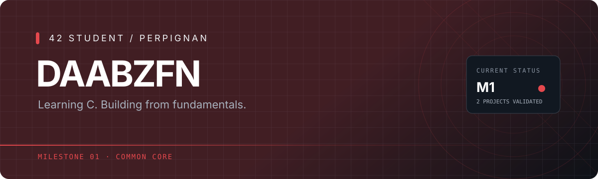

 

---

## `01` — About

I'm a student at **42 Perpignan**, currently working through **Milestone 1** of the Common Core.

My main focus right now is learning C, strengthening my programming fundamentals, and getting comfortable with problem-solving.

Beyond the 42 curriculum, I'm especially interested in **cybersecurity** and **full-stack web development** — two areas I'd like to explore more deeply.

## `02` — 42 Common Core

<strong>Milestone 1 · Current milestone</strong> — 2 validated / 4 tracked projects

 

| Project | Status | Result |
|:--|:--:|:--:|
| **libft** |  | **100%** |
| **ft_printf** |  | **100%** |
| **get_next_line** |  | In progress |
| **push_swap** *(duo)* |  | In progress |

**Tracked projects: 2 / 4 validated**

<strong>Milestones 2+</strong> — Upcoming

Not started yet. I'll update this section as I progress through the Common Core.

Progress shown here covers only the four projects listed above, not the overall completion percentage of Milestone 1 or the full 42 curriculum.

## `03` — Tools & learning

- **Currently using:** C and Git.
- **Next to explore:** Python.
- **Personal interests:** cybersecurity, web development and full-stack engineering.

## `04` — Find me

 

Learning in public. One project at a time.

