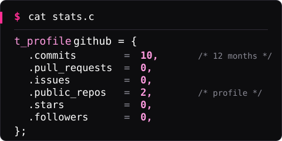
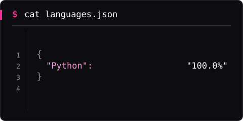
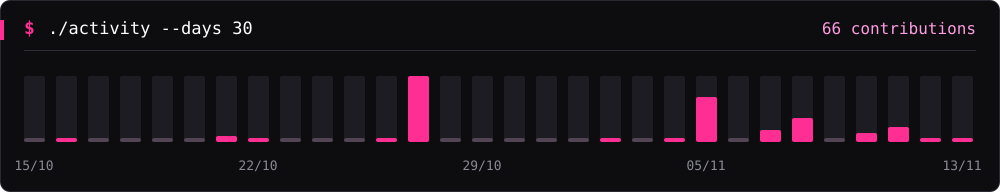
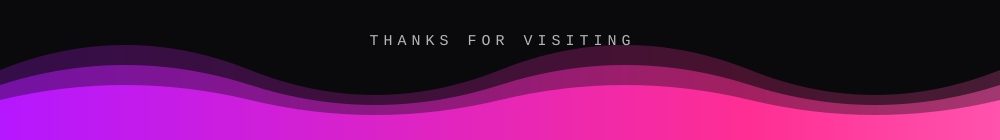

 

## `> ./about_me`

  

## `> ./stack`

**À l'école (42)**

**En projets perso (web)**

## `> ./stats`

 

  

## `> ./trophies`

## `> ./contributions`

 

<!-- Ajoute tes liens : -->
<!--  -->
<!--  -->

